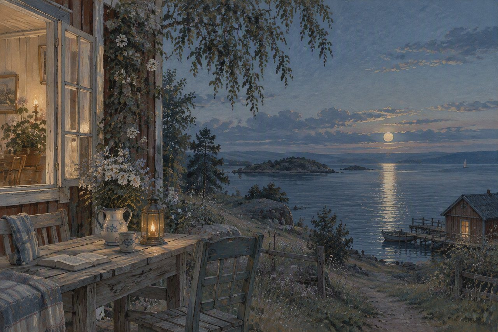

# NIRUX Theme: Carl Larsson Blue

A NIRUX theme pack: the Carl Larsson Blue colour palette and its matching wallpaper.

**Status: beta** · Part of the [NIRUX](https://github.com/nirucon/nirux) suite · [MIT License](LICENSE) (artwork excepted)



## About

Carl Larsson Blue is an optional user theme for the NIRUX desktop. It contains one palette
and one wallpaper. Once imported, every component that follows the shared NIRUX
theme picks it up: NIRUWM, NIRUBAR, NIRU Launcher, NIRUNOTIFY, NIRULOCK,
NIRUSCREENSAVER, NIRUSHOT, the NIRUPRES editor chrome, and NIRUFLOW, NIRUORG and
NIRUNOTE when they are set to **Follow NIRUX**. NIRUPRES slide themes stay
independent by design.

| Key | Value |
|---|---|
| Theme ID | `niru-carl-larsson-blue` |
| Display name | **Niru Carl Larsson Blue** |
| Background | `#0c121b` |
| Foreground | `#d9e2ee` |
| Muted | `#8d9aab` |
| Border | `#273646` |
| Focus | `#6f9bc7` |
| Wallpaper | `nirux-wallpaper-carl-larsson-blue-4k.png` (3840×2560) |

## Installation

NIRUX must be installed and `niructl` must be available (in `PATH`,
`~/.local/bin` or `~/.local/share/nirux/current/bin`). No root access is needed.

Get the pack, either as the `nirux-theme-carl-larsson-blue-VERSION.zip` asset from
[Releases](https://github.com/nirucon/nirux-theme-carl-larsson-blue/releases) (unzip it and enter
`package/`) or with Git:

```sh
git clone https://github.com/nirucon/nirux-theme-carl-larsson-blue
cd nirux-theme-carl-larsson-blue
./install.sh
```

`install.sh` runs `niructl theme-import`, which validates the theme and installs
the palette and the wallpaper into the standard per-user locations. To replace an
existing installation after a pack update:

```sh
./install.sh --replace
```

## Usage

Select the theme from **NIRU Theme Selector**, or from a terminal:

```sh
niructl theme niru-carl-larsson-blue
```

| Path | Purpose |
|---|---|
| `~/.config/niruwm/themes/niru-carl-larsson-blue.toml` | Imported palette |
| `~/.config/niruwm/themes/niru-carl-larsson-blue.assets` | Record of the wallpaper this pack installed |
| `~/Pictures/Wallpapers/NIRU/nirux-wallpaper-carl-larsson-blue-4k.png` | Wallpaper (NIRUWM `wallpaper.theme_dir`, this is the default) |

## Uninstall

```sh
./uninstall.sh
```

This runs `niructl theme-remove niru-carl-larsson-blue`. Switch to another theme first: removing
the active theme is refused.

## Status, disclaimer and how it's made

**Status: beta.** The theme files are small and stable; they follow whatever NIRUX itself does, so they move with the suite.

NIRUX and every niru* project are made by me, Nicklas Rudolfsson
([@nirucon](https://github.com/nirucon)), for me. They are tailored to my own
needs, preferences and workflows, on my own machines. If they fit yours too,
that's a nice bonus.

- **Free and open source.** Anyone is free to use, study, change and share
  it under the [MIT License](LICENSE). The wallpaper artwork has its own
  terms; see [License](#license).
- **No guarantees.** There is no warranty of any kind. Use it at your own
  risk, read what you install and keep backups of anything that matters.
- **How it's made.** Some of these projects I built from scratch by hand. In
  more recent releases I have used Claude, Anthropic's AI, to do much of the
  heavy lifting under my direction: I decide what to build and how it should
  behave, and I test it on my own machines. It saves me a lot of time, and
  the result is quite OK.
- **Alpha, beta, dev, and maybe forever.** Most things here are alpha, beta
  or dev, and may stay that way. Maybe one day there will be a real stable
  release, but given how fast development moves, and how I am as a person,
  maybe never :)

| Label | Meaning |
|---|---|
| dev | Under active construction; may not build, install or work yet. |
| alpha | Works on my machines, but incomplete or rough; expect breaking changes. |
| beta | In daily use on my machines and mostly complete; rough edges remain. |

## License

The theme files and scripts are released under the MIT License, see
[LICENSE](LICENSE). Copyright (c) 2026 Nicklas Rudolfsson.

The wallpaper artwork in `wallpapers/` is © Nicklas Rudolfsson and is not covered
by the MIT License. It is provided for use with NIRUX under the same terms as
[nirux-wallpapers](https://github.com/nirucon/nirux-wallpapers): no separate
permission or licence for redistribution is granted unless stated explicitly.
